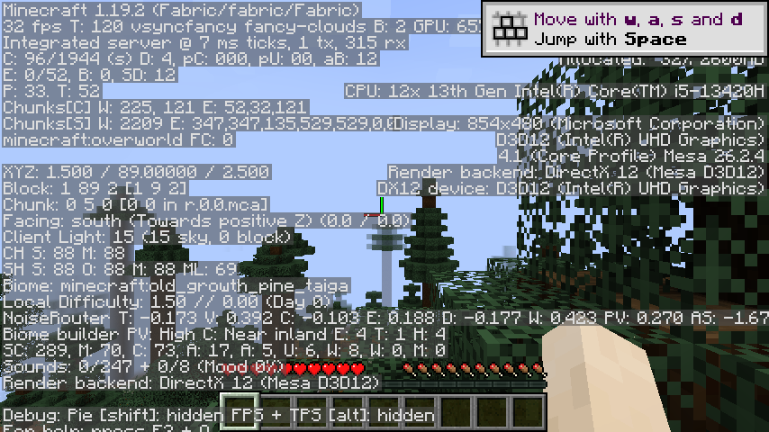

# DX12MinecraftMod

An experimental **DirectX 12 backend for Minecraft 1.19.2, Fabric, Windows x64**.

[中文](README.md) · [Releases](https://github.com/huvubb/DX12MinecraftMod/releases) · [Report a bug](https://github.com/huvubb/DX12MinecraftMod/issues/new/choose)

The mod loads the bundled [Mesa D3D12 driver](https://docs.mesa3d.org/drivers/d3d12.html) before GLFW creates the game context. Minecraft retains its OpenGL API; Mesa converts those calls into Direct3D 12 GPU work. Enabled automatically, with real renderer verification before F3 reports it as active.

**Alpha software.** Tested locally on Intel UHD Graphics with Java 21 (vanilla) and Java 17 (Iris), Fabric Loader 0.14.21. A Java 25 / Loader 0.19.3 / LWJGL 3.3.1 check also passed GUI scale changes, world rendering and saving/exiting. Iris checks and the native-memory workaround are documented in the [shader guide](docs/SHADERS.md). Long sessions, other GPUs and modpacks remain unverified. No performance improvement is claimed. Only Minecraft **1.19.2** is supported.

## Install

Use Windows x64, 64-bit Java and a D3D12-capable GPU/driver. Download the regular JAR from Releases and place it in the instance's `mods` folder. Remove the previous dx12mod JAR when upgrading. No extra JVM arguments or separate DLL installation are required.

Enter a world and press F3. Look for `D3D12 (your adapter)` and `Render backend: DirectX 12 (Mesa D3D12)`. Drivers are extracted under `.dx12mod/`; system graphics drivers and Java are not modified. For emergency diagnosis only, `-Ddx12.disable=true` disables the backend. Unsupported platforms or a different OpenGL driver loaded too early produce a startup error.



## Build and check

With JDK 21 for builds and JDK 17 for the world check installed:

```powershell
.\gradlew.bat build
.\gradlew.bat backendCheck backendDisabledCheck
.\gradlew.bat runWorldSmoke
```

Output: `build/libs/`. GPU checks need Windows x64 and a working D3D12 device. The world check creates an isolated save under `build/world-smoke/`, captures F3 and exits. The first run downloads Minecraft resources. CI only builds and checks the disabled path.

The old JNI prototype is archived in `experimental/legacy-capture/` and excluded from the release. No C++ toolchain is required.

We welcome reproducible GPU compatibility reports and controlled benchmarks. See [CONTRIBUTING](CONTRIBUTING.md), [roadmap](docs/ROADMAP.md), [architecture](docs/ARCHITECTURE.md) and [troubleshooting](docs/TROUBLESHOOTING.md).

Project code is MIT licensed. Mesa is redistributed unmodified with its own licenses and [pinned provenance](src/main/resources/natives/windows-x86_64/mesa-26.2.4/THIRD_PARTY_NOTICES.txt). Not affiliated with Mojang, Microsoft or Mesa.
